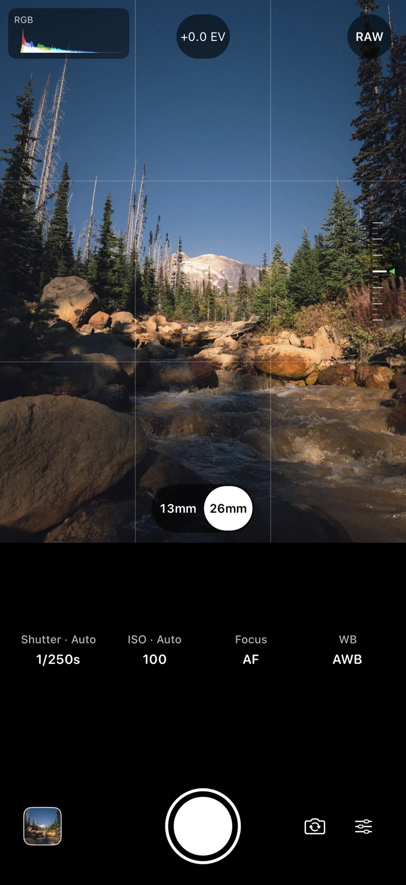
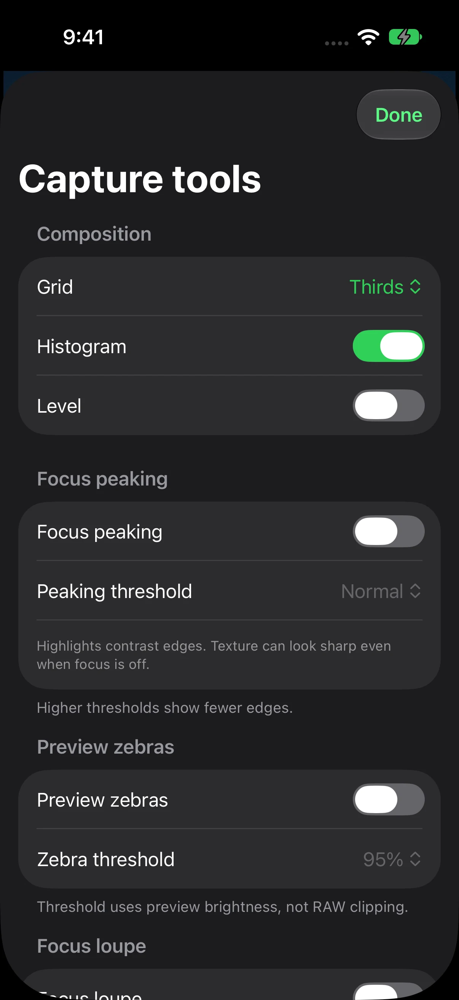
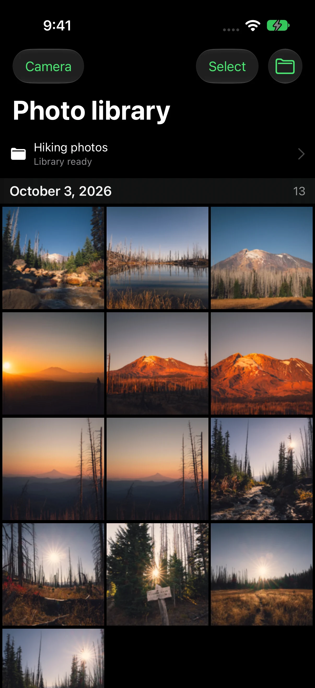
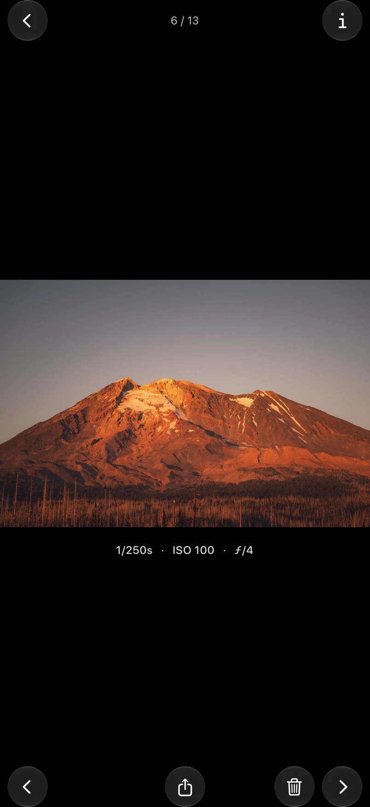

<div align="center">


# TruongCam

A lightweight iPhone camera for genuine Bayer RAW, manual controls and originals that stay in your Files library.

[Download latest IPA](https://github.com/iant4093/TruongCam/releases/latest/download/TruongCam.ipa) · [Releases](https://github.com/iant4093/TruongCam/releases) · [Build status](https://github.com/iant4093/TruongCam/actions) · [Report an issue](https://github.com/iant4093/TruongCam/issues)

[](https://github.com/iant4093/TruongCam/releases/latest/download/TruongCam.ipa)


[](https://github.com/iant4093/TruongCam/actions/workflows/ci.yml)

</div>

---

TruongCam captures individual originals without merging or editing the RAW data. Photos save to a local folder you choose in Files; the gallery, export and Recently Deleted work with that library. Reconnecting the same retained folder after a reinstall rebuilds the gallery. New photos and app records live in separate `originals/` and `metadata/` folders.

## Screenshots

Full-screen iPhone 17 Simulator captures at 1206 × 2622, with system safe areas, staged photo content and illustrative camera readings. Photography is from [my Stagman Ridge hike](https://iantruongphotography.com/album/stagman-ridge-10-3), part of the [Hikes collection](https://iantruongphotography.com/sections/photo/Hikes).

<table>
  <tr>
    <td width="50%" valign="top">
      
      <p align="center"><sub><b>Camera</b> · viewfinder, preview aids and direct controls</sub></p>
    </td>
    <td width="50%" valign="top">
      
      <p align="center"><sub><b>Capture tools</b> · composition and focusing aids</sub></p>
    </td>
  </tr>
  <tr>
    <td width="50%" valign="top">
      
      <p align="center"><sub><b>Photo library</b> · date-grouped browsing and photo management</sub></p>
    </td>
    <td width="50%" valign="top">
      
      <p align="center"><sub><b>Photo viewer</b> · fitted image, capture settings and glass actions</sub></p>
    </td>
  </tr>
</table>

## Features

**Camera**

- Genuine Bayer DNG at the highest RAW dimensions exposed by the selected camera
- RAW/JPEG switching, physical lens selection with full-frame equivalent focal lengths, and front camera support
- Persistent shutter, ISO, focus and temperature/tint white-balance controls; exposure compensation and hardware shutter/Camera Control support on compatible iPhones
- RGB preview histogram, thirds grid, level, zebras, focus peaking and a color focus loupe
- Timer, exposure and focus bracketing, interval shooting, and hold-to-shoot 1/2/5 fps targets; actual cadence depends on the camera and saving
- Portrait and both landscape orientations, with visual and haptic shutter feedback

**Library**

- RAW-derived thumbnails and a zoomable, swipeable viewer with capture settings and photo information
- Multiple selection, exact-original sharing, and an explicit Save to Photos action
- Recoverable Recently Deleted with batch recovery and confirmed permanent deletion
- Verified file commits and recovery for interrupted saves
- Bounded disposable thumbnail storage, with no third-party runtime dependencies or remote telemetry

Capabilities depend on the iPhone, lens and format. When front Bayer RAW is unavailable, front photos use a clearly labeled HEIF mode. Bayer RAW resolution can differ from the native Camera app's processed or computational modes. Preview aids analyze the live preview rather than RAW sensor data.

## Install

1. Download [the latest IPA](https://github.com/iant4093/TruongCam/releases/latest/download/TruongCam.ipa).
2. Import it into your preferred sideloading/signing tool and sign it with your own Apple account.
3. Allow camera access, then select a local library folder in Files.

Release IPAs are **unsigned**. They need signing before installation and are not App Store/TestFlight packages. GitHub does not store an Apple signing identity. The download button points to the most recent successfully published release, not an unfinished build.

Choose a retained **On My iPhone** folder outside TruongCam's own container. Cloud libraries are not supported. Deleting an app removes its own container, and another app's folder depends on that app remaining installed. Pending originals still inside TruongCam must be recovered/exported before deleting the app. Recently Deleted is never automatically emptied.

## Tech stack

| Area | Technologies |
|---|---|
| Camera | AVFoundation, physical camera discovery, native photo output |
| Interface | SwiftUI, UIKit, Liquid Glass, Core Motion |
| Preview and browsing | Core Image, Image I/O, Accelerate |
| Storage | Security-scoped Files access, coordinated filesystem operations, SQLite |
| Quality | SwiftLint, Swift 6 strict concurrency, warnings as errors, XCTest, Xcode static analysis; CodeQL for workflows |
| Delivery | GitHub Actions, unsigned arm64 IPA, SHA-256 checksums, build attestations, external dSYM |

## Build locally

Requires a Mac with **Xcode 27**, its iOS SDK and an iOS 27+ iPhone Simulator runtime. No package-manager step or third-party app dependency is required.

Open `TruongCam.xcodeproj`, select the `TruongCam` scheme, choose your development team under Signing & Capabilities, and run on your iPhone. Physical camera/RAW capability and Files-provider behavior need a real phone; Simulator results do not establish those features.

```bash
# Unsigned Debug and Release device builds
bash scripts/build.sh

# Validate and package the Release device app
bash scripts/package-ipa.sh
```

Local packages appear under `build/ipa/`. The packager verifies the Mach-O device platform, arm64 architecture, matching crash symbols and ZIP integrity. Release executables are optimized and stripped; their matching dSYM stays outside the installed app. Debug builds keep development diagnostics and are larger.

## Tests

```bash
# Pinned SwiftLint, with checksum verification on download
bash scripts/lint.sh

# Portable storage, metadata, math and state-machine regression cases
bash scripts/verify-logic.sh

# Real native XCTest execution on an available iOS 27+ iPhone Simulator
bash scripts/test.sh native
```

Native CI fails if the Simulator is unavailable; it does not silently replace native tests with portable tests. Result bundles and logs are written under the ignored `build/` directory. Detailed timing prints and the diagnostics screen are Debug-only. Release keeps local failure diagnostics through iOS-managed unified logging, without an app-owned growing text log.

## CI and releases

Pull requests and pushes to `main` run:

1. Workflow lint/security checks with actionlint and zizmor, plus Gitleaks secret scanning.
2. SwiftLint correctness checks, portable regressions and native Simulator tests.
3. Unsigned Debug/Release device compilation with strict concurrency and warnings as errors.
4. Xcode static analysis and CodeQL GitHub Actions workflow security analysis.
5. Device binary validation, IPA packaging, checksums and matching crash-symbol packaging.

After all gates pass, pushes to `main` publish a GitHub Release containing `TruongCam.ipa`, `SHA256SUMS` and `TruongCam.dSYM.zip`. The same workflow can be run manually on `main`. Pull requests never publish. Release artifacts have GitHub build provenance; publishing uses the workflow's scoped GitHub token, with no Apple certificate or provisioning secret.

CodeQL Swift tracing is currently unavailable on this toolchain: [GitHub does not support traced scans on Xcode 27/macOS 27 or Swift 6.4](https://github.blog/changelog/2026-10-19-codeql-changes-for-macos-27-xcode-27-and-swift-6-4/). CI runs CodeQL on the workflows and uses the native compiler, SwiftLint, tests and Xcode analysis for the app.

GitHub Actions are pinned to commit SHAs and Dependabot checks them weekly. CI uses GitHub's hosted `xcode-27` image to match the app's SDK. Build/test artifacts have short retention; generated output and local credentials are git-ignored.

## Repository layout

```text
.
├── src/
│   ├── TruongCam/          App, camera, capture, preview, storage, sequences and UI
│   └── TruongCamTests/     Shared regression suites and native XCTest
├── TruongCam.xcodeproj/    Native project and shared scheme
├── scripts/               Lint, test, build, validation and packaging commands
├── docs/screenshots/      Compressed README images, outside the app bundle
├── .github/               CI/release workflow and dependency-update configuration
├── .swiftlint.yml         Focused correctness rules
└── README.md
```
